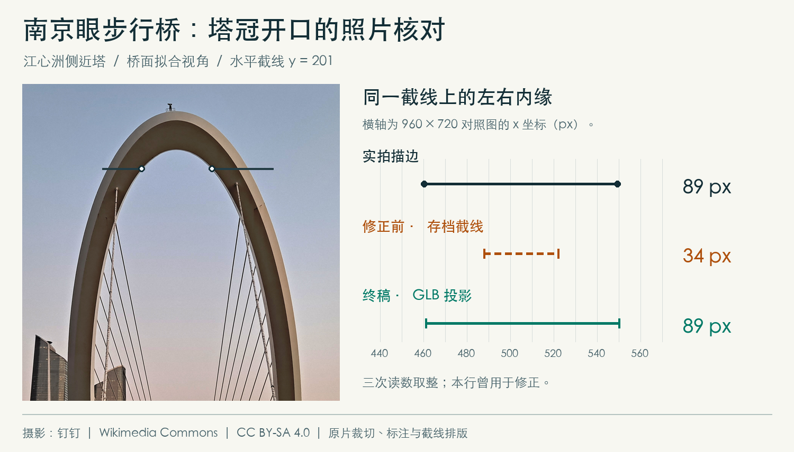

# dsm-to-threejs

`dsm-to-threejs` 是面向三维场景重建与展示的 Codex 技能。它利用多视角影像、扫描数据或既有模型识别场景对象，依据可见轮廓、已知尺寸和构件关系建立可编辑模型。根据项目用途，可进一步交付 three.js 交互场景，或使用 Blender 渲染镜头、用 Remotion 完成视频合成。

## 南京眼步行桥

桥体依据岸侧、桥面和江心洲方向的实拍影像及公开工程尺寸重建。短片以岛端弯引桥、桥面穿塔和江上双塔三个视角展示桥梁的空间关系，江岸与植被作为示意配景。成片时长 24 秒，原片规格为 1920 × 1080、24 帧/秒。

https://github.com/user-attachments/assets/78ef3bd7-49eb-4530-81f8-890fb0fdd9d0

[下载 1080p 原片](https://github.com/Yxywindows/dsm-to-threejs/releases/download/v1.0.0/nanjing-eye-1080p.mp4) · [实拍与模型的三视角对照](docs/examples/nanjing-eye/three-views.jpg)

## 直接建模后的三项校核

依据参考照片和工程尺寸可以建立初始几何。使用本技能后，建模者还能把具体疑点转化为可重复的检查。先在同一估计机位下，将模型轮廓投影回照片以定位偏差，再从交付文件中读取几何，验证构件之间的连接。下列结果来自南京眼同一次重建的初版与修订版，未设置独立的无技能对照组。

### 校核环塔的开口宽度

在 960 × 720 像素的桥面照片上，沿第 201 行量取近侧环塔两条内缘之间的距离。照片读数为 **88.91 像素**，初版模型的投影宽度为 **34 像素**。调整塔环截面的朝向和厚度后，最终 GLB 在相同机位、相同行的投影宽度为 **89 像素**。该截线参与了修订。同一张照片上另有四条截线未参与修订，其八个内缘位置的平均水平绝对偏差为 **1.19 像素**。[截线记录](docs/examples/nanjing-eye/tower-sections.csv)

### 从航拍定位引桥的线形偏差

在 960 × 640 像素的江心洲航拍影像上，沿可见桥面中心线人工标记 19 个点。固定根据桥塔估计的相机参数，计算各标点到模型中心线投影的最短距离。调整引桥的转向与曲率后，平均距离从 **138.24 像素** 降至 **1.53 像素**。这些标点参与了线形拟合，数值描述影像平面的拟合残差。被树冠遮挡的末段线形及实际高程仍存在不确定性。[标点与逐点残差](docs/examples/nanjing-eye/approach-points.csv)

### 在导出模型中逐根验证索端连接

从最终 GLB 读取 36 根斜拉索的端部几何，按所属桥塔和桥面侧别分别核对。36 根索的上端均进入对应塔体，下端均接入同侧桥缘。这项检查回答了仅凭单幅渲染难以判定的问题，即画面中重叠的构件在三维空间里是否相接。

三项校核分别针对局部形状、整体布局和构件连接。参考照片、测量位置和逐点数据可供后续版本沿用，使每次修改都能按同一口径复查。[照片来源、署名与许可](docs/examples/nanjing-eye/credits.md)

## 安装

在 Codex 中输入：

> 用 skill-installer 从 GitHub 安装 Yxywindows/dsm-to-threejs 仓库的 skills/dsm-to-threejs 目录。

安装完成后重启 Codex 以加载技能。使用仓库里的[技能目录](skills/dsm-to-threejs/SKILL.md)可以直接查看完整工作流。

## 使用示例

- **从实拍建模**：「用 $dsm-to-threejs 根据这组三视角照片重建步行桥。先判断双塔、拉索与桥面之间的位置关系，再选机位与原图核对。」
- **从模型拍片**：「用 $dsm-to-threejs 把这个 Blender 场景拍成 20 秒竖屏宣传片。用 Remotion，从街道推进到建筑入口，最后交付 MP4 和可编辑工程。」
- **交互展示**：「把这个 GLB 做成可旋转、缩放的 three.js 网页，并检查它在浏览器里的材质和构图。」

## 成片流程

先用目标画幅试拍，再从源场景渲染镜头。镜头顺序、取用帧数、标题与可选配乐都可在 Remotion 工程中调整。导出后，可以对实际解码帧、画幅、时序和声音做检查，再用联系表复核主体与字幕。只有选择视频路线才需要视频工具。[成片指南](skills/dsm-to-threejs/references/scene-film.md) · [Remotion 模板](skills/dsm-to-threejs/assets/remotion-starter/README.md)
