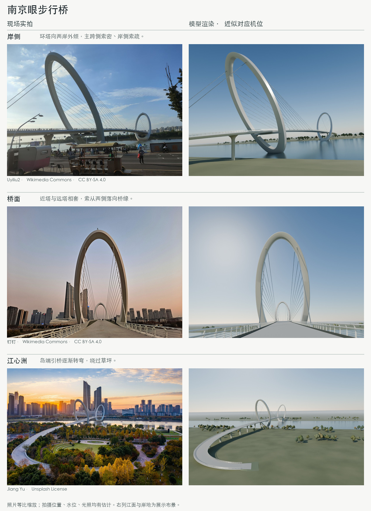
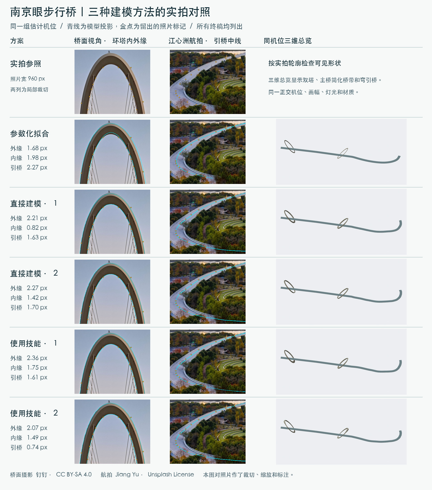

# dsm-to-threejs

**用一句话描述场景，即可查找多视角实拍图像，对照原图构建并校核三维模型，生成展示视频。**

这项 Codex 技能也支持扫描数据和已有模型，可交付可编辑模型或 three.js 交互场景。视频镜头由 Blender 渲染，使用 Remotion 剪辑合成。

## 使用方法

### 安装

在 Codex 中输入：

> 用 skill-installer 从 GitHub 安装 Yxywindows/dsm-to-threejs 仓库的 skills/dsm-to-threejs 目录。

安装完成后重启 Codex 以加载技能。使用仓库里的[技能目录](skills/dsm-to-threejs/SKILL.md)可以直接查看完整工作流。

### 在 Codex 中描述任务

> 用 $dsm-to-threejs 查找南京眼步行桥的多视角实拍图，对照原图重建桥塔、桥面和引桥，生成一支 24 秒的横屏展示视频。

也可以按已有素材和交付目标单独使用其中一项功能。

- **从实拍建模**：「用 $dsm-to-threejs 根据这组三视角照片重建步行桥。先判断双塔、拉索与桥面之间的位置关系，再选机位与原图核对。」
- **从模型拍片**：「用 $dsm-to-threejs 把这个 Blender 场景拍成 20 秒竖屏宣传片。用 Remotion，从街道推进到建筑入口，最后交付 MP4 和可编辑工程。」
- **交互展示**：「把这个 GLB 做成可旋转、缩放的 three.js 网页，并检查它在浏览器里的材质和构图。」

### 视频制作与导出

先用目标画幅试拍，再从源场景渲染镜头。镜头顺序、取用帧数、标题与可选配乐都可在 Remotion 工程中调整。导出后，可以对实际解码帧、画幅、时序和声音做检查，再用联系表复核主体与字幕。只有选择视频路线才需要视频工具。[成片指南](skills/dsm-to-threejs/references/scene-film.md) · [Remotion 模板](skills/dsm-to-threejs/assets/remotion-starter/README.md)

## 使用案例 · 南京眼步行桥

桥体依据岸侧、桥面和江心洲方向的实拍影像及公开工程尺寸重建。下图左列为现场照片，右列为模型在近似对应机位的渲染。岸侧视角用于观察双塔倾向和索面布置，桥面视角用于观察近塔与远塔的套叠关系，航拍视角用于辨认岛端引桥的转向。江岸与植被作为示意配景。

[实拍来源、摄影署名与许可](docs/examples/nanjing-eye/credits.md)

依据参考照片和工程尺寸可以建立初始几何。使用本技能后，建模者还能把具体疑点转化为可重复的检查。先在同一估计机位下，将模型轮廓投影回照片以定位偏差，再从交付文件中读取几何，验证构件之间的连接。以下三项校核记录了同一次重建的初版与修订版。本节末尾另有一组从空模型开始的独立试验，对比使用技能、直接使用 Codex 和传统参数化拟合的表现。

### 校核环塔的开口宽度

在 960 × 720 像素的桥面照片上，沿第 201 行量取近侧环塔两条内缘之间的距离。照片读数为 **88.91 像素**，初版模型的投影宽度为 **34 像素**。调整塔环截面的朝向和厚度后，最终 GLB 在相同机位、相同行的投影宽度为 **89 像素**。该截线参与了修订。同一张照片上另有四条截线未参与修订，其八个内缘位置的平均水平绝对偏差为 **1.19 像素**。[截线记录](docs/examples/nanjing-eye/tower-sections.csv)

### 从航拍定位引桥的线形偏差

在 960 × 640 像素的江心洲航拍影像上，沿可见桥面中心线人工标记 19 个点。固定根据桥塔估计的相机参数，计算各标点到模型中心线投影的最短距离。调整引桥的转向与曲率后，平均距离从 **138.24 像素** 降至 **1.53 像素**。这些标点参与了线形拟合，数值描述影像平面的拟合残差。被树冠遮挡的末段线形及实际高程仍存在不确定性。[标点与逐点残差](docs/examples/nanjing-eye/approach-points.csv)

### 在导出模型中逐根验证索端连接

从最终 GLB 读取 36 根斜拉索的端部几何，按所属桥塔和桥面侧别分别核对。36 根索的上端均进入对应塔体，下端均接入同侧桥缘。这项检查回答了仅凭单幅渲染难以判定的问题，即画面中重叠的构件在三维空间里是否相接。

三项校核分别针对局部形状、整体布局和构件连接。参考照片、测量位置和逐点数据可供后续版本沿用，使每次修改都能按同一口径复查。

### 使用技能、直接建模与传统参数化拟合

在相同的三张实拍、估计机位和公共导出器下，分别从空模型重建环塔与江心洲弯引桥。两个 Codex 条件都使用 GPT-6.2 Astra，各独立运行两次。下表按方法取均值。误差取自导出 GLB 的投影，单位为原工作图像素，数值越小越贴近照片。

| 方法 | 塔外缘 | 塔孔内缘 | 引桥中线 | 首个 GLB | 冻结终稿 |
| --- | ---: | ---: | ---: | ---: | ---: |
| 传统参数化拟合（1 次） | 1.68 px | 1.98 px | 2.27 px | 93.4 秒 | 107.4 秒 |
| Codex 直接建模（2 次） | 2.24 px | 1.12 px | 1.66 px | 129.8 秒 | 208.5 秒 |
| Codex 使用本技能（2 次） | 2.21 px | 1.62 px | 1.18 px | 117.6 秒 | 227.0 秒 |

在这组照片上，使用技能的引桥平均误差降低约 29%，直接建模的环塔内缘更准确。技能组每次多做了一轮修订，冻结终稿平均多用约 19 秒。其中一份技能组终稿的塔脚内壁有自交，三维网格检查揭示了投影图中难以察觉的缺陷。另行测试的传统特征匹配在这三张照片间未恢复出满足筛选条件的三维点。[逐次耗时、实拍叠图与测量方法](docs/benchmarks/nanjing-eye/README.md)

查看五份终稿与同一实拍的对照图

## 成果视频

镜头从江心洲弯引桥切入，沿桥面穿过近侧环塔，最后从江上回看双塔与索面。原片为 24 秒，1920 × 1080，24 帧/秒。

https://github.com/user-attachments/assets/78ef3bd7-49eb-4530-81f8-890fb0fdd9d0

[下载 1080p 原片](https://github.com/Yxywindows/dsm-to-threejs/releases/download/v1.0.0/nanjing-eye-1080p.mp4)
