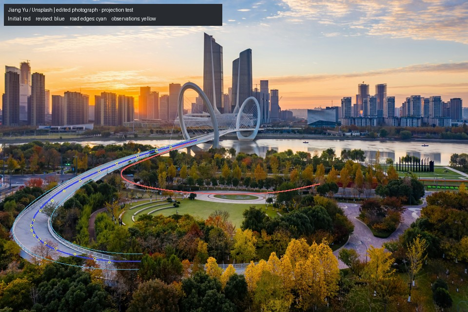

# dsm-to-threejs

一个用于三维场景重建与展示的 Codex skill。它从多视角照片、扫描或已有模型出发，先辨认地物与空间关系，再根据具体疑点选择验证方法。交付可以是可编辑模型、three.js 网页，也可以是带有真实摄影机运动的 Remotion 宣传片。

## 南京眼步行桥

这支 24 秒短片使用基于多视角实拍重建的模型。从江心洲弯引桥切到桥面，一路穿过近侧环塔，最后拉远看双塔与索面。江岸和植被用于示意。

https://github.com/user-attachments/assets/a38a4831-dbcc-4143-b502-69c701c8da79

[下载 1080p 原片](https://github.com/Yxywindows/dsm-to-threejs/releases/download/v1.0.0/nanjing-eye-1080p.mp4) · [实拍与模型的三视角对照](docs/examples/nanjing-eye/three-views.jpg)

## 相比直接建模，这个 skill 多做了什么？

按照片和公开尺寸搭出双环与桥面，已经能认出南京眼。更难判断的是，塔冠的孔是否太窄、引桥从哪里开始转弯、拉索在导出的模型里是否真的接到桥上。这个 skill 会让建模者为有疑问的部位选择对应的照片和检查方法，再据此改模型。

**塔冠的孔开得够宽吗？** 把模型投回桥面照片的估计机位，在同一高度量两条内缘之间的距离。960 × 720 的对照图上，实拍约 **89 px**，初稿只有 **34 px**。调整塔环截面的朝向和厚度后，终稿 GLB 在这里投出 **89 px**。图中虚线来自初稿的测量存档。另取四条未参与修正的截线，终稿八个边缘点与照片的平均水平偏差为 **1.19 px**。[截线数据](docs/examples/nanjing-eye/tower-sections.csv)

**同样是弯桥，转弯的位置对吗？** 在江心洲航拍上，红线是初稿中心线，蓝线是修订后的中心线，黄点是从照片读出的 19 个桥面中点。固定机位后，标点到投影中心线的平均距离从 **138.24 px** 降至 **1.53 px**。这些点参与了线形拟合。树后被遮住的末段和真实高程仍是估计。[逐点数据](docs/examples/nanjing-eye/approach-points.csv)

**渲染里看似相交的构件，导出后接上了吗？** 重新读取交付的 GLB，按两座塔、左右两侧逐根核对。36 根拉索的上端都进入对应塔体，下端都接入同侧桥缘。这项检查验证了几何连接。

以上是同一次重建在专项检查前后的实测。两版都出自这一工作流，未做相同条件下开关 skill 的独立实验。图中的像素距离描述照片上的吻合程度。[照片来源与图片使用说明](docs/examples/nanjing-eye/credits.md)

## 安装

在 Codex 中输入：

> 用 skill-installer 从 GitHub 安装 Yxywindows/dsm-to-threejs 仓库的 skills/dsm-to-threejs 目录。

安装完成后重启 Codex 以加载技能。使用仓库里的[技能目录](skills/dsm-to-threejs/SKILL.md)可以直接查看完整工作流。

## 使用示例

- **从实拍建模**：「用 $dsm-to-threejs 根据这组三视角照片重建步行桥。先判断双塔、拉索与桥面之间的位置关系，再选机位与原图核对。」
- **从模型拍片**：「用 $dsm-to-threejs 把这个 Blender 场景拍成 20 秒竖屏宣传片。用 Remotion，从街道推进到建筑入口，最后交付 MP4 和可编辑工程。」
- **交互展示**：「把这个 GLB 做成可旋转、缩放的 three.js 网页，并检查它在浏览器里的材质和构图。」

## 成片流程

先用目标画幅试拍，再从源场景渲染镜头。镜头顺序、取用帧数、标题与可选配乐都可在 Remotion 工程中调整。导出后，可以对实际解码帧、画幅、时序和声音做检查，再用联系表复核主体与字幕。只有选择视频路线才需要视频工具。[成片指南](skills/dsm-to-threejs/references/scene-film.md) · [Remotion 模板](skills/dsm-to-threejs/assets/remotion-starter/README.md)
