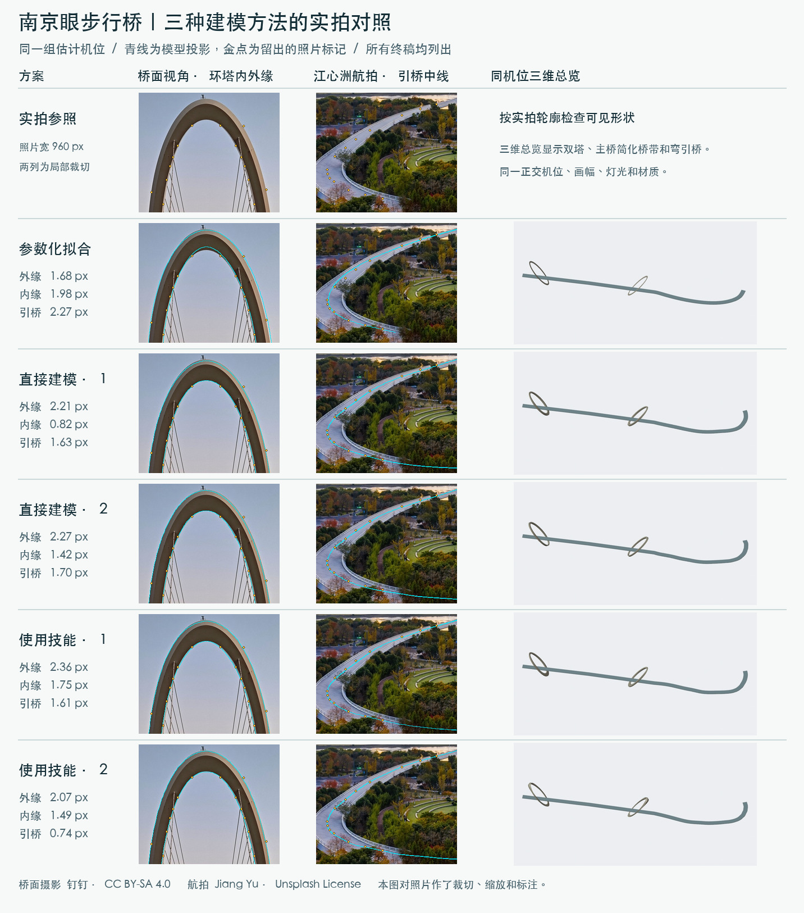

# 南京眼步行桥的建模效果与耗时对照

**同样三张照片、同款 GPT-6.2 Astra，使用 skill 的两次建模在引桥线形上平均更贴近航拍，直接使用 Codex 的两次建模在塔孔内缘上更准确。** 塔的外轮廓差距只有 0.03 像素。传统的等厚椭圆环塔取得最小的外轮廓误差和最短的首次开发时间。另行测试的纯特征匹配未恢复出可用的稀疏点。

## 三种方法生成的模型

每一行对应一次从空模型开始的独立建模。照片、图上量测位置、投影机位、工作分辨率、导出程序和材质均相同。下图显示全部五份终稿，裁图旁的误差按原工作分辨率计算。

| 方法 | 塔外缘误差 px ↓ | 塔孔内缘误差 px ↓ | 弯引桥误差 px ↓ | 首个 GLB 秒 | 冻结终稿秒 | 初稿后修订数 | 再导出秒¹ |
| --- | ---: | ---: | ---: | ---: | ---: | ---: | ---: |
| 传统参数化拟合 | 1.68 | 1.98 | 2.27 | 93.4 | 107.4 | 0 | 0.344 |
| Codex 直接建模 ① | 2.21 | 0.82 | 1.63 | 147.5 | 268.8 | 1 | 0.292 |
| Codex 直接建模 ② | 2.27 | 1.42 | 1.70 | 112.1 | 148.2 | 1 | 0.292 |
| Codex + skill ① | 2.36 | 1.75 | 1.61 | 140.7 | 264.4 | 2 | 0.292 |
| Codex + skill ② | 2.07 | 1.49 | 0.74 | 94.5 | 189.7 | 2 | 0.289 |

¹ 每份生成器在同一台 Apple M5 上启动三个独立 Python 进程，交错串行运行，表中取中位数。四个 Codex 生成器载入各自拟合好的参数。传统脚本还会重新求解椭圆与样条。15 次导出均与对应冻结 GLB 的 SHA-256 完全一致。首次及冻结耗时是墙钟时间，包含建模、工具调用和冻结前的检查，排除公共资料准备、任务派发、独立验收和视频制作。首次开发时部分任务并行，因此秒数适合描述本次运行。

[五次运行的 CSV](results.csv) · [逐个候选的误差、三项复跑记录与网格检查](measurements.json)

## 从实测结果能看出什么

- **引桥线形。** 使用 skill 的平均误差为 **1.18 px**，直接建模为 **1.66 px**，在这批照片上降低约 **29%**。技能组第二次运行达到 0.74 px，第一次为 1.61 px，接近直接建模的两次结果。四次 Codex 运行都在初稿形成了各自的引桥线形。后续修订没有改变引桥指标，主要修改的是塔。
- **环塔形状。** 两个 Codex 条件的平均外缘误差分别为 **2.21 px**（使用 skill）和 **2.24 px**（直接建模），数值差小于一个工作像素。内缘分别为 **1.62 px** 和 **1.12 px**，直接建模的两份终稿都更准确。传统固定形状取得 **1.68 px** 的外缘误差，其塔壁纵深却被求解器压到了预设下限 **0.50 m**。实桥截面纵深缺少独立观测，外轮廓误差无法验证这个尺寸。
- **生成效率。** 使用 skill 平均 **117.6 秒**出初稿，直接建模为 **129.8 秒**。技能组两次都修订了两轮，直接组均修订一轮，平均冻结耗时分别为 **227.0 秒**和 **208.5 秒**。传统组一次完成，**107.4 秒**冻结。三种方法在脚本就绪后都可在约 **0.3 秒**内再次产生相同文件。这个复跑数字只回答同一场景、同一参数的再次生成速度。
- **二维轮廓与三维质量。** 技能组第一次运行调整了塔脚内壁，最终 GLB 中每座塔各有 **120 对**不相邻三角面穿插。其余四份模型均未检出此类穿插。所有成品都能在 Blender 中打开，每个部件均闭合、面绕向一致，也都满足引桥起点坐标；单看这些检查会漏掉塔脚折叠。五份模型的 Blender 整体资产 QA 均报告两塔与其余网格分离，并提示最低点在参考零面以下。试验省略了墩与索等连接构件，五份模型均按局部几何样件解读。

## 测试如何进行

1. 两个 Codex 条件各运行两次，使用相同的 GPT-6.2 Astra 和 High 推理设置，分别开新上下文并隔离工作目录。各组都看三张实拍，获得同一组预估相机、公共尺寸、少量引导标点和导出器。直接建模组可自行测量与修订。技能组额外读取项目 skill 并自行决定如何应用。每次最多提交三份候选，冻结后再统一评分。
2. 传统组预先限定为等厚椭圆环塔和样条引桥，由同型号 Codex 实现确定性最小二乘与投影拟合。表中的 107.4 秒包含这次脚本开发和看图复核。它衡量固定几何假设下这套算法的表现，人工操作 Blender 的工时没有计入。
3. 五份模型从空几何生成。共同装配器镜像第二座塔，并把各组引桥中心线扩成同宽同厚的桥带。测量从终稿 GLB 的三角网格和桥面顶点回读。三个分项分别为三视角 **31 个外缘点**到外轮廓的最近距离、桥面照片 **7 条截线共 14 个内缘位置**的水平绝对误差，以及航拍 **14 个引桥标点**到投影中心线的最近距离。按点取平均，以 960 像素宽的工作图为基准。三项各自报告。
4. 评估标点的坐标在建模开始前单独保存。各组可在原图上自行读点。相机取自同一批影像的既有配准，全部组共用。留出坐标可检查在同批影像上的拟合；缺少其他独立机位、测绘点、坡度和截面实测。树冠遮挡了引桥末段，传统组收在最后一个公开引导点，四个 Codex 结果向后估计的长度不一。中心线误差只覆盖有留出标点的可见段。
5. 本次测了两类几何。塔外形、塔孔、引桥的结果不能直接推广到整桥、植被、建筑、车辆、材质、贴图或成片。照片检索、物体识别和相机估计已由公共准备阶段完成。两次重复可展示波动，仍不足以判断技能在新场景中的平均收益、硬件吞吐或 token 成本。

## 补充对照 · 传统特征匹配能恢复多少三维点

在五份主试验终稿冻结后，用 OpenCV SIFT 对相同的桥面、岸侧和航拍图提取了 1,276、2,115 和 4,336 个特征。以双向最近邻比值 0.75 筛选，三对照片分别留下 **8、10、8** 个候选匹配。沿同一组相机射线三角化，要求点在两个相机前方、交会角至少 1°、两幅图中各自的重投影误差均不超过 2 px，**26 个候选中有 0 个通过**。这一步用时 **0.48 秒**，没有形成可供评分的三维模型。结论限于这三张照片、估计机位和本次匹配配置；连续拍摄的高重叠序列需要另测。

[匹配数与计算设置](sparse.json)

## 图片来源

桥面照片由钉钉拍摄，岸侧照片由 Uyiliu2 拍摄，两者采用 CC BY-SA 4.0。江心洲航拍由 Jiang Yu 拍摄，采用 Unsplash License。本页对照图对照片进行了裁切、缩放和标注。桥面照片衍生面板沿用 CC BY-SA 4.0，航拍面板沿用原图许可。[桥面原图](https://commons.wikimedia.org/wiki/File:Nanjing_Eye_Footbridge_1.jpg) · [岸侧原图](https://commons.wikimedia.org/wiki/File:Full_view_of_Nanjing_Eye_Pedestrian_Bridge.jpg) · [CC BY-SA 4.0](https://creativecommons.org/licenses/by-sa/4.0/) · [航拍原图](https://unsplash.com/photos/an-aerial-view-of-a-city-with-a-river-running-through-it-mLigzKBe62g) · [Unsplash License](https://unsplash.com/license)
