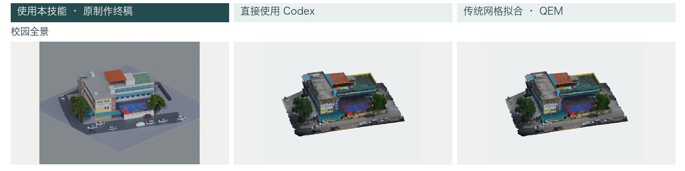
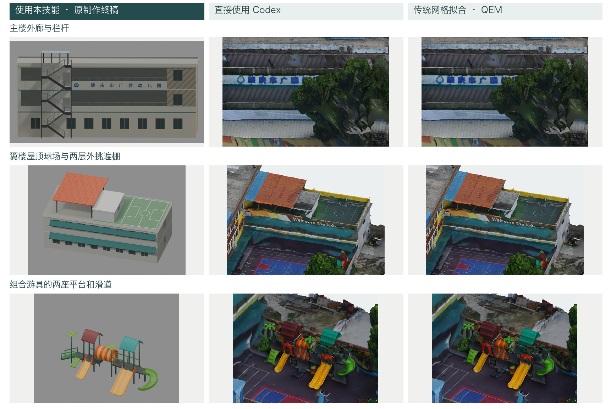

# 校园 DSM · 三份既有成品的细节对照

源数据 `DSM.obj` 是带 MTL 和 26 张纹理的摄影测量网格，含 169,936 个顶点、314,592 条三角面记录。下面并列的是以这份校园扫描为依据的三份既有交付。**技能列采用 2026 年 11 月 19 日完成树木、建筑、滑梯和逐车精修后保存的整场终稿。** 这三份文件具有不同的制作过程和交付目标。[点云、DSM 高程栅格与带纹理网格的适用范围](../../../skills/dsm-to-threejs/references/routes.md#先确认输入能支持什么)

## 车辆、树木与道路

| 地物 | 使用本技能的原制作终稿 | 直接使用 Codex | 传统 QEM 拟合 |
| --- | --- | --- | --- |
| **10 辆车** | 逐辆核对车身长轴、前后轮廓、车顶与玻璃边界。004 有较长的车顶和抬高的车尾；005 的罩布跨过风挡和引擎盖，下摆垂到轮侧；006 保留酒红色漆面与天窗。车壳和碰撞逐车独立。 | 车身、路面与墙边阴影都留在同一网格里。006 的酒红车顶和玻璃可见，车轮附近混有扫描拉伸的路面。 | 保留图集及可见车身外表，细部随整体曲面简化。006 的色块和车顶仍近似直接组，车轮没有单独的碰撞交付。 |
| **3 株主要树木** | 用各株扫描冠缘和上表面确定高低、偏冠和相接位置，给三株树分别建立树干、枝条和带透空间隙的叶簇。 | 保存照片中真实的叶团明暗，也保留冠缘向地面拉伸的扫描面。 | 在保护边界的条件下缩减叶团外壳的三角面；受遮挡的枝干沿用扫描覆盖情况。 |
| **低矮植被** | 院地另保留 3 个独立植被实例，可与乔木、地表分别选择；没有逐株精度评分。 | 低矮植被的形色保留在整场纹理网格上。 | 植被外壳参与统一减面，与地面同属一个网格。 |
| **道路、院地和地面球场** | 道路、铺装和普通标线放在一个连续 Ground 上。保留球场与院地黄色图案的相对位置，可用这一承托面逐轮检查接地。 | 原照片里的细小色差、路面斑驳、阴影和边线保存得充分。 | 同一图集映射到简化地表。蓝色球场、白线和院内黄色图案依然清楚。 |

在原终稿的逐车记录中，除去只扫到部分车身的 002，9 辆车与参考轮廓的俯视重合度中位数为 **0.853**，侧面为 **0.904**。40 个车轮均落在实际导出路面上。三株树冠的俯视重合度分别为 **0.866、0.919、0.932**。冠内分枝、叶形、车轮细部和遮挡车身含有估计，扫描没有提供真实漆号、树种或现场尺度。这些数值是原制作终稿对源扫描的验收记录。

## 建筑、游具与附属设施

| 地物 | 使用本技能的原制作终稿 | 直接使用 Codex | 传统 QEM 拟合 |
| --- | --- | --- | --- |
| **主楼与外楼梯** | 六段折返梯共 64 级。梯段接半层平台，整层平台接外廊及屋面。端墙上六扇窗分别有洞口回边、窗框、横梃和退进的玻璃；校名、徽章贴在对应承面上。 | 斜拍能读出原楼的外廊、标牌及墙面纹样；可见表面合在校园网格内。交付记录没有独立碰撞或楼层寻路结果。 | 以较少三角面保留立面和文字的扫描外观。没有按梯段、转台和楼层连接另建结构，也没有对应通路记录。 |
| **翼楼及屋顶设施** | 翼楼两排窗分别建模，朝院侧两层青色遮棚有厚度和支撑。屋顶球场、小屋、橙色屋面、水箱及其他设备可分别定位。 | 屋面色差、风化、标线与建筑表面一同保留；设施归入同一网格。 | 橙色屋面和绿色球场仍易辨认，扫描图集与简化表面共同表达屋面细部。 |
| **组合滑梯** | 红棚、青棚各盖一处平台，中间以条纹筒连接。两条黄色滑道朝西南，西侧单槽、东侧较宽且有双槽，另有支柱、护板和独立碰撞。 | 可见两座棚顶、条纹筒和黄色出口的原始颜色；缺面和遮挡反映在表面上。 | 保留扫到的平台、棚顶与滑道表面，随全场统一简化。 |
| **围墙、棚体、篮球架及路侧设施** | 3 处围护、4 处棚体、1 座篮球架、8 处交通设施与 1 处路侧设施各有实例标识。数量来自导出文件，这些小设施的尺寸没有逐件现场测量。 | 以上细部随原校园扫描保留，可在整场网格中选面处理。 | 同一处细部随整场网格简化，材质和 UV 边界受保护。 |

楼梯验收从院地出发，检查脚下承面、相邻高差、头顶净空及与墙栏的交叉。四处外廊和屋面共 **5 个目的地**，在视觉网格及碰撞网格中均可达。双滑槽的西侧 **18/18**、东侧 **24/24** 个测点均命中重建槽面，槽面相对地面的平均高度误差分别约 **0.044、0.066** 个源坐标单位。以上是模型上的几何检查；隐藏部位的结构、建筑现场安全及实际使用条件未经实测。

## 成品规格与制作耗时

| 已有交付 | 视觉网格数 | 三角面 | 内嵌图像 | GLB 大小 | 已记录耗时 |
| --- | ---: | ---: | ---: | ---: | --- |
| 技能原制作终稿 | 44 | 263,012 | 106 | 36.74 MB | 从前期建模到逐车精修跨多个阶段，未保存可与其余两组直接比较的总耗时 |
| Codex 直接建模 | 1 | 314,591 | 26 | 17.70 MB | 首个 GLB 58.9 秒，冻结终稿 161.7 秒 |
| 传统 QEM 拟合 | 1 | 157,295 | 26 | 15.18 MB | 首个 GLB 133.1 秒，冻结终稿 300.1 秒 |

直接建模成品自行选择保留扫描几何，清理了一处重复面，适合查看原始外观。QEM 以二次误差约束折叠边，文件最小，三角面约为源文件的一半。技能终稿交付了可编辑的 Blender 工程、视觉 GLB 和含 44 个实例的独立碰撞 GLB，适合需要单独修改地物、补齐结构或验证通路的任务。已有记录可以比较输出规格，无法据此给出三种方法完成同等精修工作的提速比例。

本页只采用原有验收图。车辆与校园全景直接取自逐车终稿；建筑、树木、滑梯及地表局部来自相应制作阶段。已核对这些局部的几何、变换、材质与绑定纹理和最终 GLB 一致。另两列来自各自成品的存档画面。局部图的取景、遮挡与光照随原档保留，适合判读构件和贴图表达。文件指纹、逐类数值和每张图的出处可供追溯。[成品与验收记录](measurements.json)
