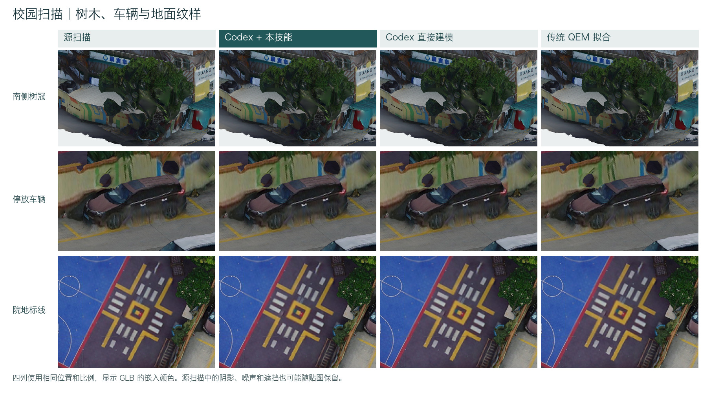

# 校园扫描｜原始数据到可编辑场景

这份校园数据包含两栋楼、屋顶与地面球场、道路、树木、车辆和一套双滑槽游具。原文件名是 `DSM.obj`，内容为摄影测量三角网格，配有 MTL 和 26 张纹理。原 OBJ 含 169,936 个顶点、314,592 个三角面记录。案例验证了**带纹理网格**这条路线。点云与 DSM 高程栅格各自有相应的输入检查。[其他输入形式](../../../skills/dsm-to-threejs/references/routes.md#先确认输入能支持什么)

## 同一份原始资料，三种处理方式

两组 GPT-6.2 Astra（High）都只收到这句话：“根据这份校园原始扫描重建一个三维场景，尽量还原现场，导出 GLB。”其中一组加载本技能，直接建模组自行决定是否拆分地物。第三组采用传统二次误差度量（QEM）拟合，把目标面数设为原始网格的 50%，保护扫描边缘、材质边界和 UV 接缝。每组从原 OBJ、MTL 和 26 张图开始，独立运行一次。模型冻结后，评估端才使用既有的 56 个源分区对照；三组都未获得分区、地物清单或验收答案。

| 方法 | 成品如何组织 | 三角面 | 文件大小 | 首个可打开 GLB | 冻结终稿 |
| --- | --- | ---: | ---: | ---: | ---: |
| Codex + 本技能 | 按地物及部件划分为 33 个网格节点，保留源面索引映射 | 314,544 | 20.14 MB | 197.8 秒 | 328.5 秒 |
| Codex 直接建模 | 自行选择保留原始几何，校园作为一个网格，清理一处重复面 | 314,591 | 17.70 MB | 58.9 秒 | 161.7 秒 |
| 传统 QEM 拟合 | 按几何误差折叠边，全场一个网格 | 157,295 | 15.18 MB | 133.1 秒 | 300.1 秒 |

计时从各组开始处理资料起，包含方法选择、制作及组内检查，不含评估方的事后核验。三个任务在同一台 MacBook Air M5 上有重叠运行时段。每种方法只有一次记录。直接建模最快，QEM 的文件最小，技能组花了更多时间判读实例、调整分区并保存源面映射。

上排的三份模型看起来非常接近。下排点选同一辆棕色车，技能组能选中该车的网格；直接建模组和 QEM 组各只有一个网格，选中范围覆盖整座校园。左列蓝色以评估方的源面分区标记目标车辆，其他列以实际 GLB 网格节点着色。

## 逐类核对地物

对每个源分区按三角面面积均匀抽取 2,048 个表面点，分别在三份 GLB 中查找最近的实际三角面。把与源表面相距 0.15 个源坐标单位以内的匹配计入节点归属。如果一个网格节点覆盖该对象至少 **60%** 的参考表面，且归到这个节点的参考表面面积至少 **80%** 来自该对象，记为一个“独立匹配”。这是本案例对单节点选择范围的检验。被多个子构件合理分担的对象也可能低于该门槛；源分区本身在相接树冠和贴地物体处亦有判读误差。

| 地物 | Codex + 技能 | Codex 直接 | QEM 拟合 | 逐类结果 |
| --- | ---: | ---: | ---: | --- |
| 主要树冠 | 1/3 | 0/3 | 0/3 | 技能组分别命名三处树冠。另两棵的节点也覆盖了对应树冠，但混入相邻表面，纯度约为 69%、78%。 |
| 低矮植被 | 0/3 | 0/3 | 0/3 | 技能组分出一处灌木对象，其边界与参考分区仍有差异。其余低矮植被多留在地面节点。 |
| 停放车辆 | 7/10 | 0/10 | 0/10 | 技能组生成 10 个车辆对象。图中棕色车的对象覆盖参考车表面约 93%，其匹配面积约 84% 属于该车。车窗、轮胎仍沿用实拍纹理。 |
| 主楼及翼楼 | 2/2 | 0/2 | 0/2 | 技能组的两栋楼都有对应主体，外梯、走廊及部分屋面另列为构件。可单独定位外梯；本轮没有验证各层之间可通行。 |
| 道路、操场与院地 | 2/6 | 0/6 | 0/6 | 院地与地面球场可单独选择。东、西、南三段道路仍归入公共地面，路面、停车线和场地绘纹沿用源纹理。 |
| 屋顶球场 | 1/1 | 0/1 | 0/1 | 技能组单列屋顶球场，球场与相邻橙色屋面可以分别选择。 |
| 屋顶附属结构 | 3/6 | 0/6 | 0/6 | 屋顶房、水箱与蓝色设备达到门槛。另两处小设备随主楼保留；橙色屋面有命名节点，边界混入邻面。 |
| 复合滑梯 | 1/1 | 0/1 | 0/1 | 技能组把整套游具列为一个对象，可单独检查。双滑槽外形和颜色来自扫描，滑槽与平台没有进一步拆为可活动构件。 |
| 篮球架 | 1/1 | 0/1 | 0/1 | 技能组单列篮球架，覆盖该参考区域约 88%。 |
| 雨棚、篷帐 | 0/4 | 0/4 | 0/4 | 可见院内红篷和沿楼挑棚，技能组对部分设施命名。四处与参考区域的独立匹配均未达到门槛。 |
| 围墙与场界 | 1/3 | 0/3 | 0/3 | 院地东墙达到门槛；北侧院墙有单独节点，但也包含相邻表面。 |
| 交通小设施 | 0/8 | 0/8 | 0/8 | 八处小设施在扫描外观中可见，三份成品都没有达到匹配门槛的独立网格。 |
| 路侧设施 | 0/1 | 0/1 | 0/1 | 该处设施随周边表面保留，三份成品均需再次选面才能单独处理。 |

分母为各类的参考实例数。7 个归属未定的参考区域仅用于估算节点纯度，逐类表列出其余 49 个区域。表中的零表示该类没有达到门槛的单独对象，地物外观仍可能完整保留在整场网格上。

## 几何、贴图和实测误差

所有成品依据各自导出记录变换到同一源坐标系。以下数值以真实 GLB 三角面及其嵌入纹理计算。对源分区求最近表面距离的第 95 百分位（P95），再在同类实例间取中位数。颜色误差为采样点三个 sRGB 通道的平均绝对差，范围为 0–255；同样按实例取中位数。数值越低，导出表面越贴近输入扫描。小于 0.00001 的距离和小于 0.01 的色差按阈值显示。源坐标单位未作现场尺度标定。

| 地物 | 技能组 P95 / 色差 | 直接组 P95 / 色差 | QEM 组 P95 / 色差 |
| --- | ---: | ---: | ---: |
| 主要树冠 | <0.00001 / <0.01 | <0.00001 / <0.01 | 0.01370 / 0.74 |
| 低矮植被 | <0.00001 / <0.01 | <0.00001 / <0.01 | 0.01408 / 1.06 |
| 停放车辆 | <0.00001 / <0.01 | <0.00001 / <0.01 | 0.01336 / 1.44 |
| 主楼及翼楼 | <0.00001 / <0.01 | <0.00001 / <0.01 | 0.01299 / 0.75 |
| 道路、操场与院地 | <0.00001 / <0.01 | <0.00001 / <0.01 | 0.01169 / 0.24 |
| 屋顶球场 | <0.00001 / <0.01 | <0.00001 / <0.01 | 0.01193 / 0.49 |
| 屋顶附属结构 | <0.00001 / <0.01 | <0.00001 / <0.01 | 0.01190 / 0.99 |
| 复合滑梯 | <0.00001 / <0.01 | <0.00001 / <0.01 | 0.01326 / 1.33 |
| 篮球架 | <0.00001 / <0.01 | <0.00001 / <0.01 | 0.01049 / 1.79 |
| 雨棚、篷帐 | <0.00001 / <0.01 | <0.00001 / <0.01 | 0.01240 / 0.42 |
| 围墙与场界 | <0.00001 / <0.01 | <0.00001 / <0.01 | 0.01299 / 0.77 |
| 交通小设施 | <0.00001 / <0.01 | <0.00001 / <0.01 | 0.01243 / 1.33 |
| 路侧设施 | <0.00001 / <0.01 | <0.00001 / <0.01 | 0.01481 / 0.45 |

- **院地黄色标线。** 在固定的俯视窗口内用相同颜色阈值提取黄色纹样。与源扫描的交并比（IoU）分别为技能组 **1.0000**、直接组 **1.0000**、QEM 组 **0.9978**。三份成品都保留了黄色图案和球场边线。
- **双滑槽。** 在东西滑槽的 42 个固定平面位置投下竖线，源扫描中有 32 处能命中游具表面。三份成品均能在这 32 处找到交点。对照最近源高度的交点，技能组和直接组的平均垂直差在显示精度内均为零，QEM 组西槽约 **0.0048**、东槽约 **0.0060** 个源单位。该检查衡量外形，滑行通路和碰撞未测。
- **建筑楼梯。** 技能组将主楼外梯独立为 `Main_external_stair`，能够单独显示、选面和复核。三份成品都基于现有扫描表面。本次没有新增逐级踏步，也没有运行通往各楼层的寻路测试。
- **网格及纹理回读。** 三份终稿均在 Blender 5.2.3 中重新打开，节点数、三角面数与独立 GLB 解析一致。各组均嵌入 26 张图。对照图采用统一的基础色与深度明暗表达，排除了不同渲染材质的光照差异。模型保留扫描的孔洞、树影与遮挡。全部回读数值、匹配对象名和文件指纹可查阅记录。[逐实例测量与文件指纹](measurements.json)

这次数据已经带有完整的可见表面和纹理。技能带来的直接收益，是将可辨地物与源面建立对应，使后续改某一辆车、某个建筑构件或游具时可以限定修改范围。在只需快速浏览原貌时，直接编译成一个网格耗时更少；在需要减少三角面时，QEM 以约一半面数保留了相近的外形和色彩。
